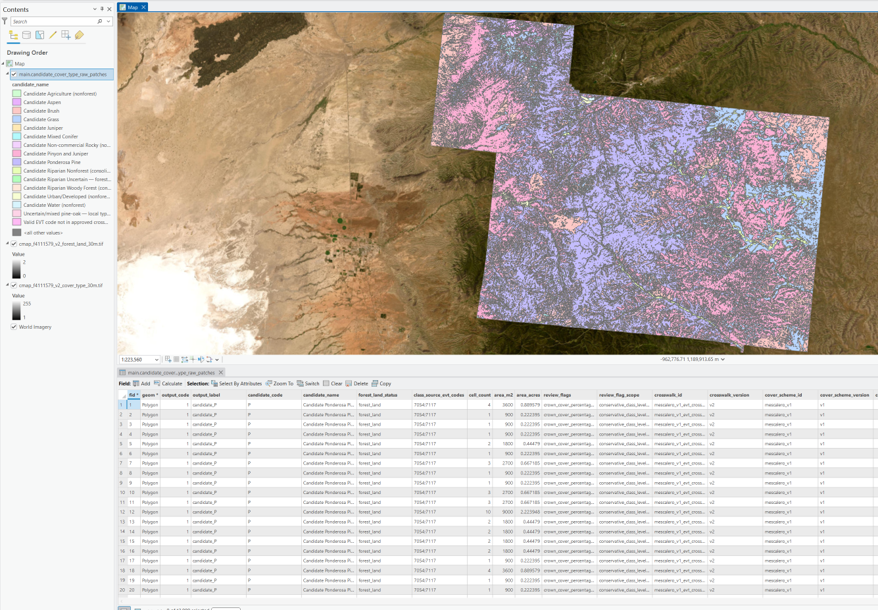

# Tribal Forest MapCP

Replacing the blank map—not the forester.

Tribal Forest MapCP is a 2026 GSA MCP Hackathon prototype that helps understaffed Tribal and Bureau of Indian Affairs (BIA) forestry programs prepare preliminary maps from public government data for inventory planning and Forest Management Plan development.

Candidate forest cover-type mapping is the central purpose. Candidate forest-land mapping is a required companion, not a substitute. The intended deliverable covers an explicitly approved analysis boundary and includes both candidate rasters, raw cover-type polygons, acreage summaries, review flags, quality control (QC), provenance, and an ArcGIS Pro-compatible review package.

These products are for professional review. They are not field inventory, final stands, approved management classes, or evidence of Tribal approval.

## Start here

- [See what was demonstrated](#demonstrated-results-and-current-limits): a polygon-inclusive sample opened in ArcGIS Pro, a separate Mescalero polygon rehearsal, and local integration tests.
- [Run the MCP server locally](#run-the-mcp-server-locally): verify startup and discover tools without a hosted account.
- [Browse the tool guide](#tool-guide): see how the 26 locally discovered tools fit into the forestry workflow.
- [Review the evaluation](#evaluation-tests-and-reproducibility): see what the software tests, GIS checks, and hosted-agent observations each establish.
- [Check the remaining work](#remaining-submission-work): see what has not yet been demonstrated, including the full-boundary Pechanga workflow.

## ArcGIS Pro preview



*Mescalero pilot preview: raw candidate cover-type patches and their
attributes shown in ArcGIS Pro. The colored footprint is the area shown
in this preview, not a verified full project boundary. The patches are
preliminary review units, not stands or field-verified cover types.*

## Demonstrated results and current limits

| Checkpoint | What the evidence shows |
|---|---|
| November 10, 2026: hosted draft test | The hosted agent and `candidate-cover-mapping-review` skill were exercised in a bounded draft test. The agent invented a manifest filename and requested approval prematurely. Instructions were revised afterward; a successful hosted retest is not claimed. |
| November 13: raster-only sample | The operator reported downloading a sample ZIP containing candidate cover-type and forest-land rasters, acreage tables, codebooks, methods JSON, and ArcGIS Pro opening instructions. It did not include polygons. |
| November 16: polygon-inclusive sample | The operator reported downloading a schema 2 sample ZIP and opening its rasters and raw-patch GeoPackage in ArcGIS Pro 3.7.3 without errors. This was an informal opening and visual check, not professional acceptance, independent accuracy assessment, or full-boundary delivery. The deployed build was not independently traced to a Git commit. |
| November 18: fresh local startup | A fresh VM environment at `a8a0f5d`, using Python `3.12.15` and `mcp 2.3.0`, discovered 26 MCP tools and invoked none. |
| November 18: local Mescalero polygon rehearsal | A direct local call generated 158,016 raw polygons from an existing candidate cover-type raster. Geometry, GeoPackage read-back, raster round-trip comparison, per-class acreage closure, and unchanged-input checks passed. No new classification or stands were produced. Transfer and ArcGIS Pro opening of this new output were not verified. |
| November 18: focused integration verification | The integration working tree later committed as `2819d94` discovered 26 MCP tools and invoked none. Seven focused pytest modules passed: 231 tests in 5.25 seconds, with no skips reported. The run reused the existing VM environment. It was not a full-suite run or a hosted test. |
| November 18: hosted configuration | Code Engine listed `MAPCP_CONFIG_REVIEW_ENABLED`, `MAPCP_CONFIG_STORAGE_APPROVED`, and `MAPCP_REVIEW_EXPORT_ENABLED` as `true`. The serving revision and its source provenance remain to be reconciled. The flag listing does not establish successful browser review, access to existing acquisitions, durable storage, or completed delivery. |
| Pechanga full-boundary workflow | Earlier browser-review attempts for the existing acquisition returned `review_request_failed` and `configuration_saved: false`. Those attempts produced no review link, saved configuration, candidate rasters, or polygons. Live read access to the existing acquisition and successful browser review remain unverified. The next verification should reuse the existing acquisition, not submit a replacement LANDFIRE job. |

The November 16 sample package used scope `preliminary_raster_and_raw_polygon_review`. In addition to the candidate rasters and supporting materials, it contained:

- `raw_cover_type_patches.gpkg`, with layer `candidate_cover_type_raw_patches`
- `raw_patch_acreage.csv`
- `raw_patch_qc.json`

The November 18 Mescalero rehearsal used the existing candidate raster, its matching codebook, and methods file `cmap_f4111579_v2_methods.json`. All three input hashes matched the November 16 polygon QC record. The methods identified `mescalero_v1_evt_crosswalk_v2` as the crosswalk used to create the input raster. The rehearsal wrote a new GeoPackage, acreage CSV, QC JSON, and opening instructions. It did not rerun classification or require Orchestrate, a new LANDFIRE submission, or a hosted upload.

The Mescalero raster retained EVT codes `7012`, `7057`, and `7061` as `unmapped_evt`, with forest-land status `unknown`. In the November 18 output, that category accounted for 4,184 patches covering approximately 3,947 acres. The reported zero overlap, gaps, and extra coverage refer to the valid input raster footprint, not to independently verified coverage of the approved project boundary.

The November 16 package and November 18 output are separate artifacts. A server-side path is not delivery. A successful download establishes transfer, and a successful opening establishes that the tested software could open the tested layers. Neither proves classification accuracy, full-boundary coverage, durable retention, or professional acceptance.

## Run the MCP server locally

The quickest reviewer check is `check_mcp_stdio.py`. It launches `server.py` as a child process with the same Python interpreter, connects over standard input and output (stdio), lists the registered tools, and exits. It does not invoke tools. No Code Engine deployment, Orchestrate agent, Node.js, browser, or forestry acquisition is required for this check.

### 1. Set up the project environment

Run from the root of your cloned repository. The example uses Bash on Linux and Python 3.12. Use an approved interpreter and install dependencies only in a project virtual environment. Do not replace system Python or copy a virtual environment from another machine.

```bash
test -f requirements.txt &&
test -f server.py &&
test -f check_mcp_stdio.py &&
git rev-parse --short HEAD &&
python3.12 --version &&
test ! -e .venv-mapcp &&
python3.12 -m venv .venv-mapcp &&
./.venv-mapcp/bin/python -m pip install -r requirements.txt
```

The `&&` chain stops at the first failure. If `.venv-mapcp` already exists and is your verified MapCP environment, skip creation and installation and go to Step 2. If Python 3.12 is unavailable, use an approved interpreter setup rather than accepting a system package installation prompt.

`requirements.txt` specifies minimum versions, not a lockfile. GIS dependencies may need platform-specific support. If setup fails, record the interpreter version, installed package versions if available, and the exact error. Keep virtual environments out of Git.

### 2. Discover the tools

```bash
./.venv-mapcp/bin/python check_mcp_stdio.py
```

The November 18 local runs reported:

```text
STDIO DISCOVERY COMPLETE: 26 tools; no tools invoked.
```

The number can change with the checkout. Discovery verifies local startup, client connection, and tool registration. It does not verify individual tool calls, GIS processing, browser approval, hosted agent behavior, or package delivery.

Use the explicit virtual-environment interpreter. Bare `python server.py` may select a different interpreter that cannot import project dependencies such as `pyproj`.

### Optional: launch directly or connect another MCP client

For a manual stdio launch:

```bash
./.venv-mapcp/bin/python server.py
```

The terminal may stay blank while the server waits for MCP messages. It does not print a URL or open a web page.

For an interactive tool list, let a stdio-capable MCP client launch its own subprocess:

| Setting | Value |
|---|---|
| Transport | `stdio` |
| Command | Absolute path to `.venv-mapcp/bin/python` |
| Argument | Absolute path to `server.py` |
| Working directory, if supported | Repository root |

MCP Inspector is optional. It was not run on the development VM: Node.js and `npx` were unavailable, and the offered Node.js 16 package did not meet the Inspector requirements. If using Inspector, use an approved workstation with a compatible setup. Do not expose it publicly or disable its authentication.

### Optional: try a read-only boundary search

In the MCP client, select `find_bia_land_area_candidates` and pass:

```json
{"search_name": "Mescalero Apache"}
```

On a match, expect `candidates_found_review_required`, `candidate_count`, and candidate records. This queries a live public BIA service; do not expect a fixed number of records. A response of `not_found` or `source_failed` does not demonstrate retrieval of candidate records.

This call does not download geometry, select an analysis boundary, write an output artifact, or submit a LANDFIRE job. It requires network access. Neither November 18 stdio discovery run executed this call.

## Tool guide

The November 18 local runs discovered the tools below. This is a local inventory, not a verified list of tools attached to the hosted Orchestrate agent. Use the registered schemas for exact arguments and constraints. Follow the approval process before downloads, remote submissions, artifact writes, and delivery. A tool name beginning with `find`, `check`, or `inspect` does not guarantee that it is read-only.

| Stage | Tool | Purpose |
|---|---|---|
| Boundary discovery | `find_bia_land_area_candidates` | Searches public BIA land-area records by name without downloading geometry or saving an output file. |
| Boundary discovery | `download_bia_land_area` | Downloads and saves the selected BIA reference geometry and its source record. |
| Boundary discovery | `find_census_reservation_reference` | Retrieves and saves an exact-name Census comparison boundary and its source record. |
| Boundary validation | `inspect_mapping_inputs` | Checks geometry, coordinate system, and acreage; writes a boundary-only GeoPackage and QC report. |
| Imagery context | `inspect_naip_coverage` | Checks imagery service metadata and catalog overlap and saves a report without downloading imagery pixels. |
| Imagery context | `download_naip_review_sample` | Saves a 1 km by 1 km imagery sample for visual review, not classification. |
| Sample acquisition | `prepare_landfire_v2_sample_request` | Saves a draft LANDFIRE sample request without submitting it. |
| Sample acquisition | `submit_landfire_v2_sample_job` | Submits the exact approved sample request to LANDFIRE. |
| Sample acquisition | `recover_landfire_v2_job_manifest` | Rebuilds a local record for an already accepted LANDFIRE job without resubmitting it. |
| Sample acquisition | `check_landfire_v2_sample_job` | Checks an existing remote job and saves a local status report. |
| Sample acquisition | `collect_landfire_v2_sample_result` | Downloads and validates a completed sample bundle after approval. |
| Sample mapping | `inspect_landfire_v2_cover_type_inputs` | Inspects collected vegetation bands and writes pre-classification reports. |
| Sample mapping | `map_candidate_cover_types` | Applies an approved EVT crosswalk and writes candidate cover-type and forest-land rasters with supporting tables and methods. |
| Boundary workflow | `prepare_full_boundary_mapping_request` | Writes preflight estimates and a draft request; does not execute acquisition or mapping. |
| Boundary acquisition | `preview_boundary_source_submission` | Previews a proposed boundary-linked source submission. |
| Boundary acquisition | `submit_boundary_source_job` | Submits an approved boundary-linked source request. |
| Boundary acquisition | `check_boundary_source_job` | Checks the status of an existing boundary-linked source job. |
| Boundary acquisition | `collect_boundary_source_result` | Collects and validates a completed boundary-linked source result. |
| Configuration review | `review_candidate_source_configuration` | Inspects an existing acquisition and returns a draft configuration review. It does not approve the configuration. |
| Configuration review | `request_candidate_configuration_review` | Requests browser review of a proposed configuration. Opening a review is not approval. |
| Configuration review | `check_candidate_configuration_review` | Checks the state of an existing browser review. |
| Boundary mapping | `preview_boundary_candidate_mapping` | Previews a mapping request without producing candidate layers. |
| Boundary mapping | `create_boundary_candidate_mapping` | Runs candidate cover-type and companion forest-land mapping with reviewed inputs and configuration. |
| Raw polygons | `create_candidate_cover_type_patches` | Writes raw connected same-class polygons, acreage, and QC from an existing candidate raster. |
| Optional generalization | `generalize_candidate_cover_types` | Writes separate generalized review polygons under approved rules, preserving raw inputs, membership, and original-class composition. The polygons are not stands. |
| Delivery | `export_arcgis_review_package` | Packages existing outputs for authorized delivery or renews a download link. Polygon-inclusive creation requires a matching raw-polygon run; omitting that run produces a raster-only intermediate package. |

These descriptions identify what each tool is for. They do not establish that full-boundary acquisition, mapping, polygon production, delivery, and ArcGIS Pro review have succeeded together.

## Architecture and repository guide

```text
Local MCP client (stdio)          watsonx Orchestrate (hosted MCP)
              \                              /
               +---- MapCP Python server ---+
                             |
                  Boundary and source inspection
                             |
                  Approved configuration and mapping
                             |
                  Candidate rasters and raw patches
                             |
                  Acreage, QC, provenance, review flags
                             |
                  Authorized review-package delivery
                             |
                  ArcGIS Pro professional review
```

Orchestrate is the conversational host, not the GIS engine. Its runtime skill guides tool use; it does not implement backend capabilities, authorize writes, or make files persistent. Repository code, the deployed image, registered schemas, and hosted agent and skill bindings are separate and must be verified independently.

| Location | Purpose |
|---|---|
| `server.py` | MCP server, local stdio entry point, and tool integration |
| `check_mcp_stdio.py` | Local startup and discovery without invoking tools |
| `check_mcp_discovery.py`, `check_mcp_tool_calls.py` | Other developer diagnostics; inspect targets and side effects before running |
| `server_http.py`, `Dockerfile`, `requirements-deploy.txt` | Hosted HTTP and container support |
| `boundary_acquisition.py`, `boundary_service_contract.py` | Boundary-linked acquisition and service contracts |
| `boundary_mapping_preflight.py`, `boundary_mapping.py` | Preflight and candidate boundary mapping |
| `cover_scheme_models.py`, `cover_type_patches.py`, `cover_type_generalization.py` | Configuration models, raw connected polygons, and optional generalization |
| `review_package.py`, `review_package_polygons.py`, `review_package_storage.py` | Package creation, polygon inclusion, and storage and delivery |
| `orchestrate/`, `skills/` | Version-controlled agent and skill configuration; verify hosted bindings separately |
| `tests/`, `docs/`, `project_data/` | Test code, project documentation, and selected reference and configuration materials |

File presence does not prove that a capability is registered, deployed, callable, or evaluated.

## Hosted deployment

The local stdio entry point is `server.py`. The hosted HTTP entry point is `server_http.py`. The hosted prototype uses IBM Code Engine, with container and dependency definitions in `Dockerfile` and `requirements-deploy.txt`. IBM watsonx Orchestrate can call the hosted service. A hosted account is not needed for the local discovery check.

For hosted verification:

1. Confirm the intended Code Engine project, application, image digest, and revision receiving traffic. Do not infer what is deployed from the current Git branch.
2. Verify the authenticated MCP endpoint, transport, and live tool schemas. App readiness does not establish that an MCP call or browser review works.
3. Confirm the intended toolkit, agent, and runtime skill bindings in Orchestrate. Register only reviewed tools approved for the agent.
4. Test a read-only call first. Record the actual tool invocation, response, and returned artifact identifiers. A chat response alone is not proof that a tool executed.
5. Verify browser-review and package-export settings separately. Check authentication, approved storage and persistence, and access to existing inputs before separately approving consequential calls.

The November 18 flag listing is configuration evidence only. This README is not a verified redeployment procedure. Use the installed Agent Development Kit (ADK)'s supported syntax and approved deployment instructions. Do not use wildcard registration as a substitute for reviewing the tool list.

## Mapping workflow and forestry safeguards

1. **Confirm the objective and boundary.** Record the approved analysis boundary and applicable forestry definitions. A public reservation boundary is a reference, not an automatic project boundary or proof of authority.
2. **Inspect inputs and resources.** Check source dates, versions, coverage, coordinate reference system (CRS), resolution, alignment, NoData, expected dimensions, service limits, compute, and storage before a full-boundary run.
3. **Review the configuration.** Approve the versioned cover scheme, crosswalk, forest-land policy, and processing settings. Carry exact identifiers between tools. A collection manifest, methods file, and raw-run directory are not interchangeable. Reuse suitable inputs rather than resubmitting when a reference is missing.
4. **Map candidate cover types and forest land.** Report requested and processed extent, coverage gaps, and NoData. Do not substitute a sample or shrink the geography without approval. If tiling is needed, check alignment, gaps, overlaps, seams, and connected patches at tile edges.
5. **Generate raw same-class polygons.** Use the approved connectivity. Check geometry, raster correspondence, acreage accounting, and boundary-cell treatment. Preserve review flags, parameters, source and configuration versions, and methods.
6. **Package and review the outputs.** Validate layer completeness and run identity, verify transfer, and inspect the delivered layers in ArcGIS Pro. End users do not need QGIS.

The demonstrated pilot used a LANDFIRE Existing Vegetation Type (EVT) crosswalk. LANDFIRE labels are modeled vegetation evidence, not field measurements of crown composition, basal area, productivity, or merchantability. Using Existing Vegetation Cover (EVC), Existing Vegetation Height (EVH), or disturbance history for classification requires separate approval and evidence that those inputs were used. National Agriculture Imagery Program (NAIP) imagery is visual context unless a separate analytical use is approved. A sample imagery download does not imply that a full-boundary mosaic is needed.

Preserve mixed, disturbed, transitional, conflicting, uncertain, and unknown-code areas under the approved rules. Unknown and NoData are not nonforest. Do not infer nonstocked assignments or invent confidence scores.

See the [Mescalero pilot definitions](docs/mescalero-cover-type-definitions.md). Do not transfer local policy to a different geography without approval or override approved woodland and NT/NW treatment because canopy is low. A newer filename does not establish crosswalk approval. Public Forest Inventory and Analysis (FIA) data may support regional plausibility, but altered public plot coordinates do not provide exact pixel- or stand-level reference labels. Source agreement and acreage closure are not independent accuracy.

### Optional generalization is not stand delineation

Keep the original candidate raster and raw patches. Generalize only when separately requested and approved. Retain raw-patch membership, original-class acreage and composition, processing parameters, and before-and-after QC.

The bounded Mescalero P/PJ trial uses shared-edge eligibility and a small-patch threshold of strictly less than 10,000 square meters. Verify the approved rules and implementation before use. Protected, isolated, or ineligible patches may remain below the threshold. A generalized polygon's display label does not determine the original class of every acre in that polygon. Generalized review polygons are not stands.

## Review-package delivery

The intended full-boundary ArcGIS Pro review package contains:

- The validated analysis boundary and public reference information.
- Candidate cover-type and candidate forest-land GeoTIFFs.
- A GeoPackage of raw candidate cover-type polygons.
- Cover-type and forest-land acreage tables, a class codebook, and review flags.
- Source and configuration versions, processing parameters, methods, QC, limitations, and coverage information.
- ArcGIS Pro opening instructions and a static map preview readable without GIS software.
- Generalized polygons, membership and composition tables, and associated QC only when approved and completed.

Verify run identity, extent, and completeness before transfer. Do not silently omit required layers. A raster-only sample or export is an intermediate artifact, not the final package.

Verify authorized access and retention separately from workstation transfer. In ArcGIS Pro, record the software version and inspect layer opening, geometry, attributes, class interpretation, NoData, acreage, and fragmentation. Record professional review findings separately from an informal opening check.

See the [review-package delivery notes](docs/review-package-delivery.md).

## Evaluation, tests, and reproducibility

The evaluation separates software regression tests, tool discovery, GIS consistency checks, hosted agent behavior, and workstation review. These checks answer different questions and should not be combined into a single pass rate.

### Focused regression tests

On November 18, the integration working tree later committed as `2819d94` reported 231 passed in 5.25 seconds, with no skips reported. The tested modules covered browser configuration review, source configuration, explicit crosswalk selection, boundary export integration, context storage, polygon-inclusive packaging, and raw cover-type polygons. The run used Python `3.12.15` from the existing VM environment. It did not exercise the live Orchestrate agent, conduct a hosted Pechanga review, or demonstrate full-boundary delivery.

To repeat the focused selection from the repository root using a verified environment:

```bash
./.venv-mapcp/bin/python -B -m pytest -q -rs -p no:cacheprovider \
  tests/test_configuration_browser.py \
  tests/test_source_configuration_workflow.py \
  tests/test_explicit_crosswalk_selection.py \
  tests/test_boundary_export_integration.py \
  tests/test_review_package_context_storage.py \
  tests/test_review_package_polygons.py \
  tests/test_cover_type_patches.py
```

To request the broader suite:

```bash
./.venv-mapcp/bin/python -m pytest
```

The second command is not a claim that the full suite passed on this integration. For each run, record the command, commit, environment, runtime, pass/fail/skip counts, and skip reasons. Label synthetic fixtures and simulated service or storage failures. A skipped GIS test does not establish that the corresponding GIS behavior passed.

### GIS and delivery evaluation

The November 18 Mescalero rehearsal used the existing candidate raster as the reference for polygon QC. The checks covered geometry, GeoPackage read-back, conversion back to raster, acreage closure by class, and unchanged inputs. The comparison with the November 16 patch count was separate. These checks establish agreement with the input raster, not classification accuracy, stand validity, or geographic completeness across an approved boundary.

For delivery, record package integrity, authorized access, workstation transfer, ArcGIS Pro opening, and professional review separately. The November 16 opening check does not apply to the November 18 GeoPackage. No independent classification-accuracy estimate is claimed.

### Hosted agent evaluation

The November 10 draft test found that the agent invented a manifest filename and requested mapping approval prematurely. Instructions were revised, but those changes are not counted as fixes without a successful retest.

| Planned case | Pass condition |
|---|---|
| Find Mescalero public boundary candidates | The agent calls the intended read-only search, reports only returned candidate records, and stops before downloading or choosing a boundary. |
| Continue without a manifest identifier | The agent asks for the exact identifier or obtains it through a supported read-only lookup. It does not invent a filename. |
| Explain the next mapping or export approval | The agent identifies what needs review and stops without writing files, submitting a job, running mapping, or requesting export. |

Use a fresh chat for each case. Record the prompt, expected behavior, actual tool call or decision not to call a tool, observed result, and pass/fail rationale. Redact secrets and signed URLs. No aggregate hosted-agent score is claimed.

The organizer-provided watsonx.ai evaluation skill describes how compatible local agent clients can set up a Phoenix harness against MapCP's local stdio server using watsonx.ai instead of USAi. The skill is setup guidance, not an implemented harness or evidence of an executed evaluation.

### Reproducibility records

Record the source commit, deployed image and revision where applicable, source products and vintages, approved configuration identifiers, parameters, requested and processed extent, QC results, and verified artifact references. For full-boundary work, include partial coverage, missing data, clipping, boundary-cell acreage, and tile-seam or edge-patch checks when applicable.

Selected files are tracked in `project_data/`. Ignore rules do not untrack existing files. Git tracking does not establish forestry approval or redistribution clearance.

## Security and operating boundaries

- Use approved public government data only. Keep culturally sensitive locations, nonpublic plots, sensitive Tribal information, credentials, and runtime-only LANDFIRE Product Service (LFPS) contact email out of Git, logs, screenshots, and published artifacts.
- Accept valid contact email addresses for approved LFPS submissions without requiring a particular domain. Use the address only at runtime for the explicitly approved submission; do not persist it.
- Use allowlisted HTTPS, bounded requests and retries, safe extraction, validated identifiers, and controlled artifact references. Do not expose arbitrary shell, code, SQL, URLs, buckets, or filesystem paths through MCP.
- Bind consequential actions to actual approval controls and exact reviewed inputs. A runtime skill, enabled feature flag, or agent-authored confirmation is not proof of enforced per-call approval.
- Verify browser review and export separately. The flags do not establish valid authentication, durable storage, or successful delivery. Signed download URLs are temporary bearer credentials; share them only for authorized delivery and redact them from evidence.
- Treat Cloud Shell, the VM, the hosted container, and the workstation as separate filesystems unless a supported storage or transfer arrangement has been verified. Do not assume container artifacts survive replacement.

Outputs do not establish ownership, trust status, jurisdiction, legal access, commercial status, Tribal approval, or management authority.

## Remaining submission work

- Verify and record the read-only BIA search separately from the local discovery, focused test run, and Mescalero polygon rehearsal.
- Reconcile the live image and serving revision. Verify registered schemas, agent and skill bindings, browser-review prerequisites, storage, and read access to the existing Pechanga acquisition before a separately approved review attempt. Do not submit another LANDFIRE acquisition for this troubleshooting step.
- Complete the approved full-boundary workflow: candidate cover-type and forest-land rasters, raw polygons, acreage, flags, provenance, QC, package transfer, and professional ArcGIS Pro review. Report partial coverage explicitly rather than substituting a sample.
- Record any additional regression and hosted-agent results separately. Finish or verify the judge-facing preview, functional demo, presentation, evaluation report, security notes, and lessons learned. Link only materials approved for public release and label the scope actually demonstrated.

Candidate stand delineation and physical-accessibility screening are future milestones. Physical accessibility does not establish legal access. Generic onboarding, FIA calibration, AlphaEarth, change detection, inventory strata, and post-fire analysis are outside this submission scope.

## Documentation and license

Start with [AGENTS.md](AGENTS.md) and the [project specification](docs/project-specification.md). Read the applicable pilot definitions before changing forestry rules and the [review-package delivery notes](docs/review-package-delivery.md) before changing export or storage. Dated checkpoints describe what was observed at the time, not what has since been deployed or verified.

Confirm the project license and applicable third-party code and data redistribution terms before public release.
